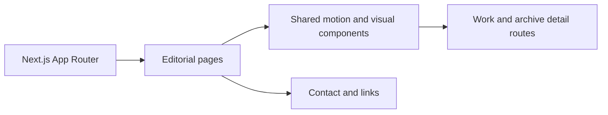

<div align="center">
  

  <p>
    
    
    
    <a href="LICENSE"></a>
  </p>
</div>

## ✦ The site

Atelier is Christopher Joshy's personal website, built as an editorial portfolio rather than a template grid. It has dedicated routes for work, notes, experiments, links, current focus, achievements, and an archive.

## 🧵 Page composition



## 🎨 Design details

- Custom page composition and typography in the App Router.
- Framer Motion and Lenis support page and scroll motion.
- Reusable spotlights, capability map, cursor, and editorial-ending components.
- Tailwind CSS utilities plus project-specific global styles.

## 🧰 Stack

| Area | Tools |
|---|---|
| Framework | Next.js 15, React 19, TypeScript |
| Styling | Tailwind CSS, custom CSS |
| Motion | Framer Motion, Lenis |
| Icons/utilities | Lucide React, `clsx`, `tailwind-merge` |
| Hosting config | Vercel |

## 🚀 Run locally

```bash
git clone https://github.com/ChristopherJoshy/Atelier.git
cd atelier
npm ci
npm run dev
```

Open `http://localhost:3000`. To create a production build:

```bash
npm run build
npm start
```

## 🗂️ Layout

```text
app/         routes and page layouts
components/  reusable editorial and motion components
lib/         site data and helpers
assets/      custom client-side interactions
```

## 📄 License

MIT. See [`LICENSE`](LICENSE).